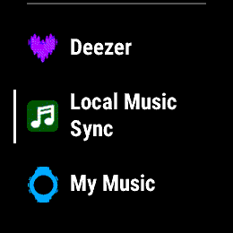
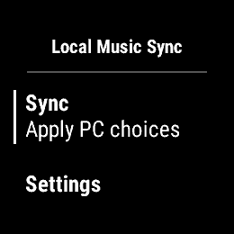
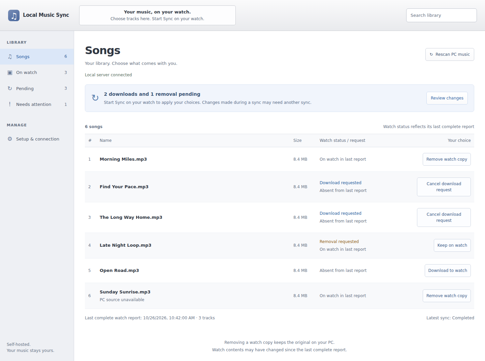
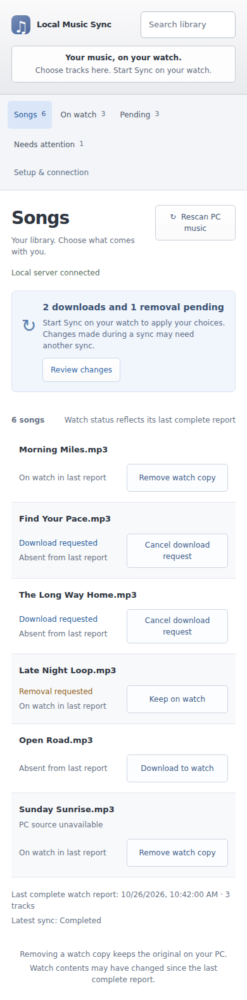

# Local Music Sync

[](https://github.com/andriimazur93/garmin-sync/actions/workflows/ci.yml)

Local Music Sync is a self-hosted music manager for the Garmin Forerunner 955. Choose
MP3s from a folder on your PC, request downloads or removals in a local browser,
then start **Sync** on the watch. Downloaded tracks play offline through Garmin's
native music player.

**First time here?** Follow [Getting started](GETTING_STARTED.md) for the ordered
PC setup, HTTPS connection, watch installation and first music sync.

It supports one owner, one watch and one MP3 directory. The PC shows the watch's
last **complete reported inventory** and its timestamp; a disconnected watch is
not treated as empty. Removing a watch copy never deletes the PC original.

The ordinary release was tested on a Forerunner 955 running firmware 29.05:
download, complete inventory, offline headphone playback before and after a
restart, removal, and recovery from an unavailable HTTPS endpoint worked. A
three-minute stereo MP3 also downloaded and played; a repeat Sync through a
stable HTTPS address completed without another download.
Physical interrupted-transfer recovery and storage/battery impact were not
measured. Results on other firmware or MP3 files may differ.

## Screenshots

Forerunner 955 captures showing the music-provider list and the app menu.
The provider-list capture shows an earlier app icon.

| Select the music provider | Start sync or open settings |
| --- | --- |
|  |  |

The management page on desktop, showing music choices, pending changes and the
watch's last reported inventory. Both browser screenshots use sample music and a simulated
report; they are interface previews rather than physical-watch validation.



Mobile layout:



## Run the PC server

Tested on Ubuntu 24.04 with Python 3.12. Use a project-local environment:

```bash
python3.12 -m venv .venv
.venv/bin/python -m pip install -r requirements-build.lock
.venv/bin/python -m pip install --no-build-isolation -r requirements-dev.lock
cp -n .env.example .env
```

Edit `.env`: set `GARMIN_SYNC_MUSIC` to an existing MP3 directory and
`GARMIN_SYNC_DATA` to a private persistent directory. Quote paths with spaces.
Keep `.env` private. In one terminal:

```bash
set -a
. ./.env
set +a
.venv/bin/python -m garmin_sync.cli serve-admin
```

In a second terminal, load `.env` the same way and run
`.venv/bin/python -m garmin_sync.cli serve-device`. Open the management page at
**http://127.0.0.1:8000**. The separate device API listens at
**http://127.0.0.1:8001**. Both default to loopback; expose only port 8001
through HTTPS. There is no frontend build step, Garmin OAuth login or phone
companion app.

For Docker Compose, set `GARMIN_SYNC_MUSIC` in `.env` to an **absolute, existing**
directory readable by the container, then run:

```bash
docker compose config --quiet
docker compose up --build -d --wait
```

Compose publishes both ports on PC loopback only. Music is mounted read-only;
the named `state` volume holds the database and credentials. The `scratch` volume
may temporarily contain audio bytes during delivery. `docker compose stop` and
`docker compose start` preserve state. Do not use `docker compose down --volumes`
unless you intend to delete the state volume.

## Give the watch a private connection

Generate the server's device token once and save it outside Git:

```bash
mkdir -p .local
(
  umask 077
  .venv/bin/python -m garmin_sync.cli init > .local/device-settings.json
)
```

For Compose, replace the final command with
`docker compose exec -T admin python -m garmin_sync.cli init`. Keep the output
file private; it contains the device token. The watch needs that token and the
public HTTPS root URL of the device API.

For a free stable URL without a purchased domain, install
[Tailscale](https://tailscale.com/docs/install/linux) on the machine running the
device listener, sign in to its Personal plan, then run:

```bash
sudo tailscale up
tailscale funnel --bg 8001
tailscale funnel status
```

Funnel may first prompt you to enable it in your account. Its status shows an
`https://…ts.net` URL. It exposes local port **8001**, never the management page
on 8000. Keep the PC server and Funnel running when you sync. Funnel currently
has [bandwidth limits](https://tailscale.com/docs/features/tailscale-funnel),
so check a full MP3 transfer on your setup.

For temporary testing, a [Cloudflare Quick Tunnel](https://developers.cloudflare.com/tunnel/concepts/)
can expose `http://127.0.0.1:8001`; its URL changes after a restart. Update the
watch settings whenever the URL changes. A browser login challenge cannot be
used for the device API because the watch sends a bearer token directly.

## Build and configure the watch app

Install [Garmin Connect IQ SDK](https://developer.garmin.com/connect-iq/connect-iq-basics/getting-started/)
9.3.0, Java 17 and the `fr955` device package separately. You also need your own
private DER developer signing key. These tools and keys are not bundled. From
the repository root:

```bash
export CIQ_SDK_HOME=/absolute/path/to/sdk-9.3.0
export GARMIN_SIGNING_KEY=/private/path/developer.der
export PATH=/absolute/path/to/java-17/bin:$PATH
bash scripts/build-watch.sh
```

The ordinary output is `dist/garmin-sync-fr955.prg`. Copy it to
`GARMIN/Apps` on the watch over USB, then safely eject. In the app's **Settings**,
enter the HTTPS root URL and device token. The token editor does not display a
saved token. Keep configuration files containing these values private. Builds
made with `--tests` or `--smoke` are development artifacts; use the ordinary PRG
for the watch.

## Sync and manage music

### First sync checklist

This path assumes Ubuntu 24.04, a Forerunner 955, a local MP3 folder, and a
stable HTTPS URL. Keep the PC awake and connected while setting up and syncing.

1. **Start both server processes.** Start `serve-admin` and `serve-device` in
   separate terminals as described above. Keep both running. Open
   `http://127.0.0.1:8000` on the PC and confirm the management page loads.
2. **Expose the device API.** Set up Tailscale Funnel as described above and
   copy the `https://…ts.net` address from `tailscale funnel status`. The root
   URL is the address alone, with no `/api` path. Confirm the device service is
   healthy at `https://YOUR-NAME.ts.net/health` in a browser.
3. **Save the device token.** Run the init command above once and save its
   output privately. It contains `device_token` and `server_id`; the HTTPS root
   URL comes separately from Funnel. Do not share the token or configuration file.
4. **Install and configure the app.** Get the ordinary FR955 PRG and matching
   checksum from [GitHub Releases](https://github.com/andriimazur93/local-garmin-music-sync/releases),
   or build it using the SDK steps above. Copy the PRG to the watch's
   `GARMIN/Apps` folder over USB, safely eject the watch, then open
   **Local Music Sync → Settings** and enter the HTTPS root URL and device token.
   The saved token is not shown again. Development builds marked `--tests` or
   `--smoke` are not for normal use.
5. **Select one test track.** Put an MP3 in the configured music folder. In the
   PC page, rescan the folder and choose **Download to watch** for that track.
   Keep the first transfer small enough to complete comfortably.
6. **Start sync from the watch.** Choose **Sync** in the watch app and leave it
   connected until sync reports completion. On first contact, the PC page may
   ask you to confirm the watch/server association. Confirm it before managing
   removals.
7. **Check the result.** Refresh the PC page. The track should appear in the
   last complete watch inventory, with a recent report time. On the watch,
   select the track in Garmin's native music player and play it through paired
   headphones. For a true offline check, turn off Wi-Fi on the watch before
   playback; Bluetooth headphones remain connected separately.

If the watch reports a connection or request error, check that both server
processes and Funnel are still running, the URL and token in watch Settings are
correct, and the PC can open the HTTPS `/health` address. If sync completed but
the PC page has not changed, reopen or refresh the page; the watch reports its
inventory during sync. To retry a track, check its inventory and pending state
before requesting it again.

After the first sync, rescan the music folder in the PC page whenever its files
change. Choose **Remove watch copy** and Sync again to remove a track from the
watch while retaining the PC original.

### Manage your library

The PC page uses one searchable song list. **Songs** shows the full library,
**On watch** shows the last complete reported contents, **Pending** shows
requested downloads and removals, and **Needs attention** shows unavailable
sources, operation errors and retained unknown cache entries. Search combines
with the selected view.

The pending banner summarizes your choices; **Review changes** opens the Pending
view. Use **Cancel download request** or **Keep on watch** to change a pending
choice where available. Start **Sync on the watch** to apply choices. Changes
made during a sync may need another sync because its plan is already fixed.

**Setup & connection** contains setup guidance and the watch association status;
new associations also display a confirmation prompt. URL/token changes still
use watch Settings, and PC folder changes use your installation configuration.
The page refreshes while visible and preserves search and keyboard focus. If the
local server disconnects, the last report remains displayed with its timestamp;
**Retry connection** reloads status. A connected PC server does not mean the
watch is online. Before the first complete report, watch inventory is unknown.

The watch downloads sequentially through Garmin's media cache. Completed work
and cache mappings survive restarts. Missing PC source files do not request
watch deletion, and unknown cache entries are retained. If a plan or cache
capacity limit is reported, remove known tracks or sync smaller batches.

## Back up and recover

Back up the PC music directory separately. For a native installation, stop both
services and copy the **entire** `GARMIN_SYNC_DATA` directory, including any
SQLite `state.db-wal` and `state.db-shm` files. Restore it with both services
stopped. Treat the backup as a secret: it contains identity, token, membership,
sessions and reported inventory.

For Compose, stop both services, archive the named state volume into a private
local directory, then start them again:

```bash
mkdir -p .local/backups
chmod 700 .local/backups
docker compose stop
(
  umask 077
  docker compose run --rm --no-deps -T admin tar -C /data -cf - . > .local/backups/state.tar
)
docker compose start
```

Restore only into a fresh empty state volume; do not merge databases. After any
restore, review desired music choices and run a manual Sync. If server state was
lost, a new identity/token is created, inventory is initially unknown, and the
watch/server association must be confirmed again before removals.

## Continuous integration

GitHub Actions runs the Python server test suite, builds the Python wheel and
builds the Docker image on pushes to `main`, pull requests and manual runs. The
wheel is available as a workflow artifact for 14 days. The Garmin watch build
is not part of hosted CI: it requires the separately installed Connect IQ SDK
and a private developer signing key. CI results also do not replace physical
watch testing.

## Contribute

See [CONTRIBUTING.md](CONTRIBUTING.md) for development rules. The device API uses
bearer authentication, immutable sync plans, idempotent operation results and
atomic complete inventory reports. JSON pages are limited to 20 entries and
8192 UTF-8 bytes including their envelopes. Server endpoints are implemented
under `src/garmin_sync/`; the watch client is under `watch/source/`.

Project code is [Apache-2.0](LICENSE); see [third-party notices](THIRD_PARTY.md).
Accounts, payments, browser uploads, transcoding, streaming and music from
other providers are outside this project's scope.

See [CHANGELOG.md](CHANGELOG.md) for user-visible changes and current release
status.
